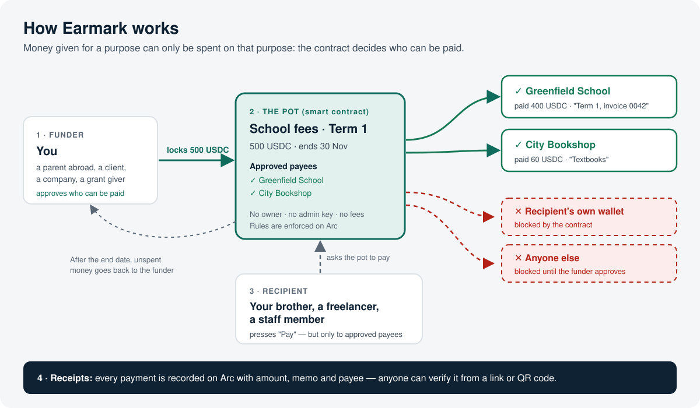

# Earmark

**Money with a purpose.** Give someone money that can only be spent on what it was meant for.

**Live app:** https://arcearmark.duckdns.org · **Network:** Arc mainnet · **Built with [Arc Studio](https://studio.arc.io)**



---

## Earmark in 30 seconds

You send your brother **500 USDC for school fees**. With a normal transfer, the money is his: it can be spent on anything, and you have no proof of where it went.

With Earmark, you put the 500 USDC into a **pot** labelled "School fees · Term 1" and you approve **Greenfield School** and **City Bookshop** as the only places it can go. Your brother can still decide **when** to pay and **how much**, but the smart contract will **only** send money to those two. If he tries to pay himself or anyone else, the payment is blocked.

Every payment comes with a **public receipt** (amount, memo, who was paid) that anyone can check from a link or a QR code. If money is left over after the end date, **you take it back**.

> Think of it as giving someone a prepaid card that only works at the shops you chose, with every swipe visible to both of you.

---

## Who it's for

| Situation | Funder (puts the money in) | Recipient (spends it) | Approved payees (can be paid) |
|---|---|---|---|
| **Money sent home** | You, working abroad | Your brother or parent | The school, the landlord, the hospital |
| **Household bills** | Parent or flatmate who covers bills | The person who handles the bills | Electricity company, internet provider, water board |
| **Freelance work** | A client | The freelancer | The suppliers the job needs: a hardware store, a print shop, a hosting provider |
| **Staff allowances** | A company | An employee travelling for work | Approved hotels, transport companies |
| **Grants and scholarships** | A foundation or sponsor | A student or researcher | The university, the lab supplier |
| **Aid and relief** | An NGO | A family receiving support | A pharmacy, a clinic, a food supplier |
| **Event budgets** | A couple or organiser | The event planner | The caterer, the venue, the decorator |

In every case, the person spending the money can't send it to themselves or anyone the funder hasn't approved.

---

## How it's different

| | Normal transfer | Escrow | **Earmark** |
|---|---|---|---|
| Who controls the money after sending | The recipient, fully | Nobody, until a condition is met | The **recipient spends it**, but **only to approved payees** |
| Can it be spent on something else? | Yes | Not applicable | **No: blocked by the contract** |
| Proof of where it went | No | Partly | **A public receipt for every payment** |
| Unspent money | Stays with the recipient | Returned or released | **Back to the funder after the end date** |

---

## How it works, step by step

1. **Create a pot.** The funder sets a purpose ("School fees · Term 1"), an amount in USDC, an end date, and at least one approved payee (a wallet address plus a name such as "Greenfield School").
2. **Approve who can be paid.** Only those addresses can receive money from the pot. The recipient can **ask** for a new payee (for example a new clinic); the funder approves or rejects it.
3. **The recipient pays.** They pick an approved payee, an amount and a memo ("Term 1, invoice 0042"). The contract checks the rules and sends the USDC straight to the payee.
4. **Anyone can verify.** Each payment has a public receipt page with a QR code, plus a downloadable receipt image, linked to the transaction on the Arc explorer.
5. **Leftovers.** After the end date the funder can take back what's unspent. At any time, the funder can choose to release the rest to the recipient with no restrictions.

### Roles

| Role | Can | Can't |
|---|---|---|
| **Funder** | Create and fund pots, add or remove payees, approve or reject payee requests, top up, extend the end date, release the rest, take back unspent money after the end date | Be a payee of their own pot |
| **Recipient** | Pay approved payees, ask for new payees | Pay themselves, pay anyone not approved, withdraw the money |
| **Approved payee** | Receive payments | Nothing else; no account needed, just a wallet address |

### What the contract guarantees, and what it doesn't

**Guaranteed by the contract on Arc:**
- Money only goes to approved payees.
- The funder and the recipient can never be payees of their own pot.
- No owner, no admin key, no upgrades, no platform fees.
- Unspent money returns to the funder after the end date.

**Not guaranteed:**
- Earmark can't verify **who owns** an address. Get the school's or supplier's wallet address from them directly.
- Payments can't be reversed.
- Only USDC on Arc is supported.

> ⚠️ Experimental, and not independently audited. Use small amounts.

---

## Live on Arc mainnet

| | |
|---|---|
| App | https://arcearmark.duckdns.org |
| Earmark contract | [`0x0dD4101D457679AE8C942f56f91F7B1eEC1aEa5B`](https://explorer.arc.io/address/0x0dD4101D457679AE8C942f56f91F7B1eEC1aEa5B) |
| Deploy transaction | [`0xb3e1b81e…2a9e`](https://explorer.arc.io/tx/0xb3e1b81e355e2070a7d9708ea1028652f2663059ad812239e21052459a3f2a9e) (block 27249934) |
| USDC (Arc) | `0x3600000000000000000000000000000000000000` |
| Testnet contract | [`0x7d5b050e1c3fd772cacc1e59d3381b5c30b9d566`](https://explorer.testnet.arc.io/address/0x7d5b050e1c3fd772cacc1e59d3381b5c30b9d566) |

---

## Built with Arc Studio

Earmark was designed and built in **Arc Studio**: the Solidity contract, its 61 Foundry tests, the security review, the React app and the testnet deployment were all written and iterated there, then pushed to this repository. The mainnet contract is the same `contracts/Earmark.sol`, deployed with Foundry.

---

## For developers

```bash
bun install
bun run dev                     # app on http://localhost:5173
forge test                      # 61 contract tests (run from the repo root)
```

Configure the network with environment variables:

```bash
VITE_NETWORK=mainnet                                              # or testnet
VITE_EARMARK_ADDRESS=0x0dD4101D457679AE8C942f56f91F7B1eEC1aEa5B
VITE_EARMARK_FROM_BLOCK=27249934                                  # deploy block, limits log scans
```

```bash
bun run build                   # production build → dist/
```

### Pages (hash routing)

| URL | Page |
|---|---|
| `#/` | Home |
| `#/send` | Create a pot |
| `#/sent` | Pots I fund |
| `#/received` | Pots for me |
| `#/pot/:id` | Pot page (public, no wallet needed) |
| `#/receipt/:potId/:index` | Payment receipt (public, downloadable image with QR code) |
| `#/how` | How it works |
| `#/about` | About |

---

## Roadmap

Planned, not built yet:

- **Sign in with Google**, so recipients and payees don't need to know about crypto wallets.
- **Fee sponsorship**, so new users can pay with 0 USDC in their wallet.
- **A shareable recipient ID** instead of long wallet addresses.
- **Top-ups straight from an exchange.**
- **Cash-out to local currency** for schools, landlords and suppliers.

## License

The contract source is MIT-licensed (see the SPDX header in `contracts/Earmark.sol`).
